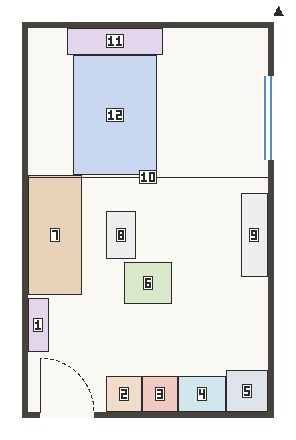
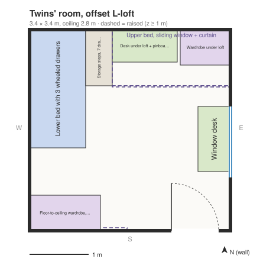
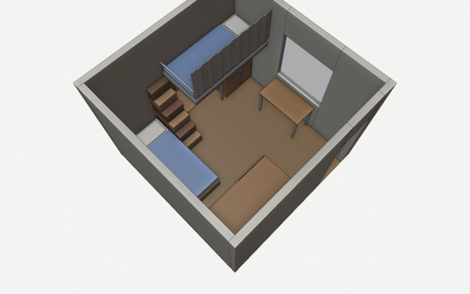
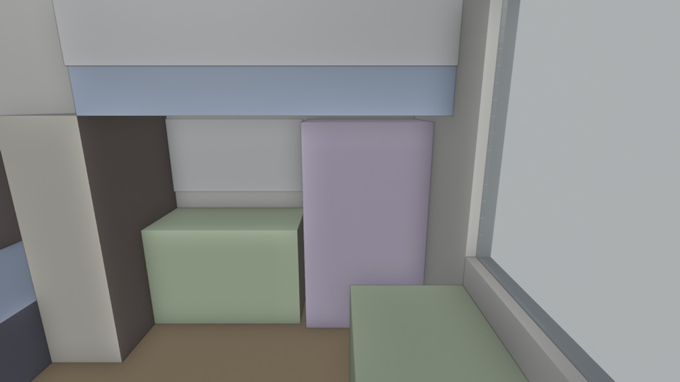

# Residential Space Designer

[](https://github.com/puvankumarv/residential-space-designer/actions/workflows/ci.yml) [](LICENSE) [](https://github.com/puvankumarv/residential-space-designer/releases/latest)

**Website:** https://puvankumarv.github.io/residential-space-designer/

**One skill for every space in the home.** It's a Claude skill that designs residential interiors, from a single cramped room to a whole apartment or house:

- **Bedrooms:** kids', twin and shared rooms with loft, bunk, half-height and wall beds
- **Kitchens:** galley, L, U and island layouts
- **Bathrooms:** fixture layout and wet/dry split
- **Living and dining rooms**
- **Entryways, corridors and stairs**
- **Balconies and laundry**
- **Home offices**
- **Studios and whole-home planning:** room allocation, adjacency, and the wet-room stack
- **Exterior and site:** car and pedestrian arrival, privacy from the street, courtyards, verandahs and terraces
- **Indian and Western ways of living:** pooja rooms, Vastu if wanted, dry and wet kitchens, elders on the ground floor; or drop zones, open kitchens with sight lines, mudrooms and ensuites

You give it dimensions, photos, a floor plan or a spoken description. For each room it produces:
- a design brief and zone plan,
- a layout JSON (`templates/layout.schema.json`) that the checker validates and that can be exported to 3D and rendered in Blender,
- an ASCII floor plan, a bill of materials and safety notes,
- a zone-by-zone reveal script that doubles as the camera path for a walkthrough video.

For a whole home it first makes a **home plan** (rooms, adjacency, circulation), then designs room by room.

## What's inside

| Path | What it is |
|---|---|
| `residential-space-designer/SKILL.md` | The skill: room modules, procedure, deliverables |
| `residential-space-designer/references/rooms/` | One module per room type: `bedroom/`, `kitchen.md`, `bathroom.md`, `living-dining.md`, `entry-circulation.md`, `balcony-laundry.md`, `home-office.md`, `whole-home.md`, `exterior.md` |
| `residential-space-designer/references/regional/` | `india.md` and `western.md`: room programs, cultural preferences and climate responses |
| `residential-space-designer/references/` | Shared rules with source tags: safety, dimensions, storage, services, materials, sources |
| `residential-space-designer/templates/` | Layout JSON schema, intake questions and brief, BOM |
| `residential-space-designer/scripts/check_layout.py` | Layout checker, standard-library Python |
| `residential-space-designer/scripts/floor_plan_svg.py` | Draws a layout as an SVG floor plan |
| `residential-space-designer/scripts/mcp_server.py` | MCP server: checker, metrics, edits, comparison, PNG and SVG plans, 3D model, references as tools, resources and prompts |
| `residential-space-designer/scripts/layout_tools.py`, `plan_png.py` | Room metrics, layout edits, option comparison, and the PNG plan renderer |
| `residential-space-designer/scripts/layout_to_gltf.py` | Turns a layout into a 3D model (glTF 2.0) |
| `residential-space-designer/scripts/blender_walkthrough.py` | Renders that model as a still or walkthrough video in Blender |
| `.claude-plugin/plugin.json` `mcpServers` | Registers the MCP server when the plugin is installed |
| `residential-space-designer/examples/` | Twins' loft bedroom, galley kitchen, compact bathroom, studio apartment |
| `residential-space-designer/evals/` | Test scenarios, generated layouts and results |
| `docs/` | Project website (GitHub Pages) |
| `.claude-plugin/` | Claude Code plugin and marketplace manifests |
| `tests/` | Unit tests run by CI |
| `interior-design-research/` | Research notes: existing skills, MCPs and models; small-space case-study notes; whole-home tour notes (`home_tours.md`); draft rules |

## What the checker verifies

- **Every room:** collisions, room bounds, door swings, clearance in front of furniture, outlets near beds and desks, day/night states for convertible furniture.
- **Sleeping areas:** raised-bed guardrails, access and headroom, upper-bed age, lower-bunk headroom, bedside access, an escape window for every sleeping area (including rooms split by partitions).
- **Kitchens:** work-aisle and walkway widths, work-triangle legs and total.
- **Bathrooms:** toilet side and front clearance, basin clearance, shower size and entry clearance.
- **Living rooms:** distance from the sofa to the coffee table.
- **Stairs:** riser, tread, width and headroom.
- **Windows:** fall protection on high floors, and climbable furniture under windows.
- **Structure:** niches in load-bearing walls.

Each rule cites its source: CPSC, EN 747, IRC, NKBA, Neufert/Panero or IES (see `references/sources.md`).

## Install

**Claude Code: plugin (recommended)**
```
/plugin install residential-space-designer --marketplace puvankumarv/residential-space-designer
```
On older Claude Code versions, add the marketplace first:
```
/plugin marketplace add puvankumarv/residential-space-designer
/plugin install residential-space-designer@residential-space-designer
```

**Any agent that supports skills: skills CLI**
```bash
npx skills add puvankumarv/residential-space-designer
```

**Claude app (claude.ai / desktop):** download [`residential-space-designer.zip`](https://github.com/puvankumarv/residential-space-designer/releases/latest/download/residential-space-designer.zip) from the latest release and upload it under Settings → Capabilities → Skills, where custom skills are available on your plan.

**Manual:** copy the skill folder into your skills directory:
```bash
git clone https://github.com/puvankumarv/residential-space-designer.git
cp -r residential-space-designer/residential-space-designer ~/.claude/skills/
```

Then describe your room or home ("my twins share a 3.4 × 3.4 m room…", "plan our 30×40 Vastu house…") and the skill loads automatically.

## MCP server

The plugin starts a small MCP server (standard-library Python, no install) with ten tools:

| Tool | What it does |
|---|---|
| `validate_layout` | Checks a layout and returns `errors`, `warnings`, `ok`, and ASCII plans if asked (structured output) |
| `room_metrics` | Free floor (m² and %), storage volume, hanging rail, sleeping places, seats, worktop run, glazing ratio against the IRC 8% rule (structured) |
| `edit_layout` | Moves, resizes, rotates, adds, removes or changes elements and re-checks in the same call (structured) |
| `compare_layouts` | Ranks 2 to 6 options by errors, warnings, free floor and storage, with a one-line summary (structured) |
| `floor_plan_png` | A PNG picture of the plan with a numbered legend, so Claude can look at what it designed |
| `floor_plan_svg` | Draws a layout as a labelled SVG floor plan, one state at a time |
| `layout_to_gltf` | Builds a 3D model of the room as glTF 2.0 JSON, furniture shaped by type |
| `get_layout_schema` | Returns the layout JSON Schema |
| `list_references` | Lists the room modules, regional modules, rules and examples |
| `read_reference` | Reads one of those files |

It also offers:

- **Resources:** every reference, template and example as `rsd://skill/<path>`, so you can attach them with `@` in Claude Code.
- **Prompts:** `design_room` (room type, size, occupants, region, brief) and `review_layout`. Claude Code shows them as slash commands. `design_room` attaches the matching room module, the regional module and the safety rules.
- **Completions** for prompt arguments (room types, regions) and resource paths.
- **Both protocol eras:** the `initialize` handshake (2024-11-05 to 2025-11-25) and the stateless 2026-07-28 revision with `server/discover`. Claude Code connects with 2026-07-28.





Installed through the Claude Code plugin, it starts by itself. For other MCP clients (Claude Desktop, Cursor and others), clone the repository and add:

```json
{
  "mcpServers": {
    "residential-space-designer": {
      "command": "python3",
      "args": ["/path/to/residential-space-designer/residential-space-designer/scripts/mcp_server.py"]
    }
  }
}
```

## 3D model and walkthrough video

Turn any layout into a 3D model (standard-library Python):

```bash
python3 residential-space-designer/scripts/layout_to_gltf.py residential-space-designer/examples/twins-offset-loft.json room.glb
```

The model has the floor, walls cut around doors and windows, glass in the windows, and every element at its real size, shaped by type: beds with a mattress, duvet and pillows (and a guardrail on lofts), sofas with arms and cushions, cabinets and wardrobes with doors, drawers and handles, counters with stone worktops, a sink bowl and a hob, appliances, sanitaryware, stairs, shelves and pleated curtains. Materials are wood, fabric, metal, ceramic, stone and glass. Add `--boxes` for one plain box per element. There is no ceiling, so you can look in from above. It opens in Blender, Windows 3D Viewer, macOS Quick Look, or the [3D viewer on the website](https://puvankumarv.github.io/residential-space-designer/viewer.html).

Render it with Blender (or `pip install bpy` on Python 3.11):

```bash
blender -b -P residential-space-designer/scripts/blender_walkthrough.py -- room.glb orbit.mp4
blender -b -P residential-space-designer/scripts/blender_walkthrough.py -- room.glb walk.mp4 --mode walk
blender -b -P residential-space-designer/scripts/blender_walkthrough.py -- room.glb view.png --still
```

`--mode orbit` (default) circles the room from above. `--mode walk` stands at eye height just inside the door and looks around. `--engine cycles` gives realistic lighting but renders slowly; the default Workbench engine takes seconds.

| Orbit view | Standing in the doorway |
|---|---|
|  |  |

## Check a layout

```bash
python3 residential-space-designer/scripts/check_layout.py residential-space-designer/examples/studio-apartment.json --plan
```

Draw it as an SVG floor plan:

```bash
python3 residential-space-designer/scripts/floor_plan_svg.py residential-space-designer/examples/studio-apartment.json --state day > plan.svg
```

Add `--json` to the checker to get the result as one JSON object (`errors`, `warnings`, `ok`, and `plans` with `--plan`) for scripts and other tools. The exit code is 1 when there are errors.

## Development

```bash
python3 -m unittest discover -s tests -v
```
CI runs these tests on every push: checker rules, every shipped layout, and the skill and plugin manifests. Pushing a `v*` tag that matches `.claude-plugin/plugin.json` builds the ZIP and publishes a GitHub release. See [CHANGELOG.md](CHANGELOG.md).

## Status

v1. Code values are minimums. NKBA and design-guide values are recommendations. Values tagged `[std]` are common practice and must be confirmed. Always check local building codes, and have structure, gas, electrics and waterproofing done or signed off by professionals.

Design patterns were studied from public renovation videos and written up in our own words. The case-study notes in `interior-design-research/` are paraphrased summaries, not transcripts.

## Roadmap

1. ~~Blind test of the skill on the scenarios in `evals/scenarios.md`.~~ Done in v1.1.0.
2. ~~MCP v1: `validate_layout` and `floor_plan_svg` tools.~~ Done in v1.2.0. MCP v2 (metrics, edits, option comparison, PNG plans, resources, prompts, 2026-07-28 protocol) added after v1.3.0.
3. ~~Blender stage: layout JSON to scene to walkthrough video.~~ First version done in v1.3.0: glTF export, Blender stills and videos, web viewer. Furniture shapes and materials added after v1.3.0.
4. Inputs: photo to dimensions, voice (Whisper), video to 3D reconstruction.
5. Multi-room home layouts in a single file.

## License

[MIT](LICENSE) © 2026 Puvan Kumar V. The research notes in `interior-design-research/` summarise public videos in our own words. The videos themselves belong to their creators.
